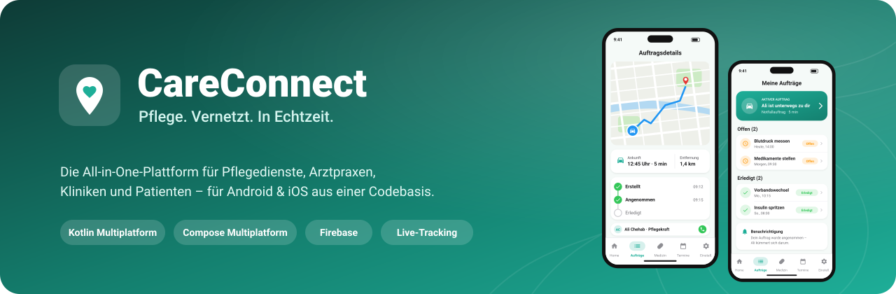
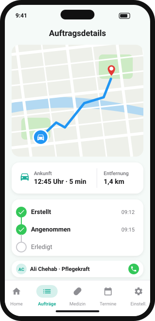
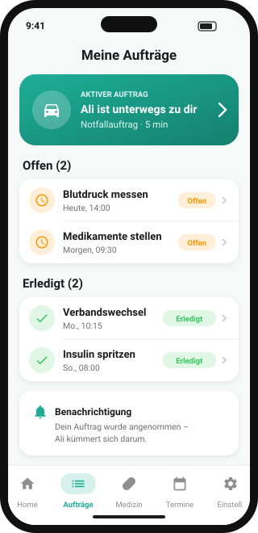
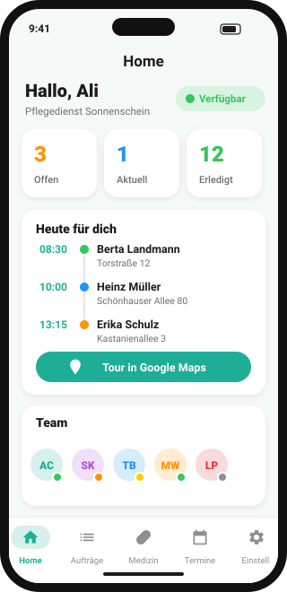
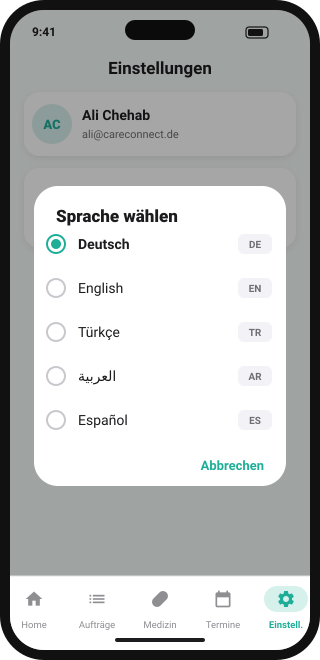
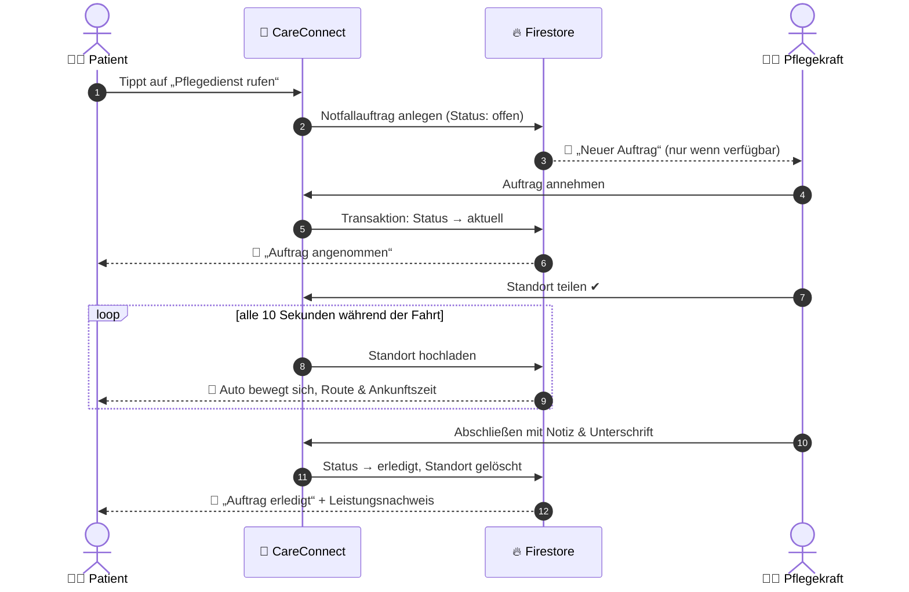
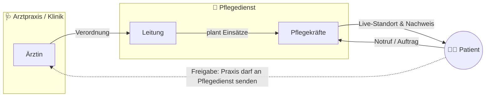
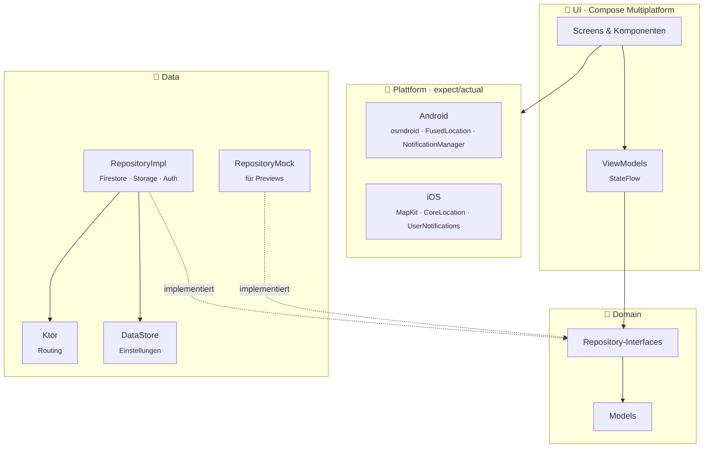

<div align="center">



<br/><br/>


**Eine App. Zwei Plattformen. Alle Beteiligten der Pflege an einem Ort.**

[Highlights](#-highlights) · [Einblicke](#-einblicke) · [Features](#-features) · [So funktioniert's](#-so-funktionierts) · [Architektur](#-architektur) · [Tech-Stack](#-tech-stack) · [Setup](#-setup)

</div>

---

## 💡 Über das Projekt

In der ambulanten Pflege laufen Informationen oft über Zettel, Anrufe und Messenger: Wer fährt zu wem? Wann kommt die Pflegekraft? Was hat die Arztpraxis verordnet?

**CareConnect bringt Pflegedienste, Arztpraxen, Kliniken und Patienten in einer App zusammen.** Patienten lösen mit einem Tipp einen Notfallauftrag aus und verfolgen live, wann Hilfe ankommt – so wie man es von Lieferdiensten kennt. Pflegekräfte sehen ihre Tour für den Tag, nehmen Aufträge an und dokumentieren den Einsatz mit Unterschrift direkt auf dem Handy.

Das Projekt ist der Neubau meiner ursprünglichen iOS-App (SwiftUI) mit **Kotlin Multiplatform**: Geschäftslogik **und** Oberfläche sind einmal in Kotlin geschrieben und laufen nativ auf **Android und iOS**.

<table>
<tr>
<td align="center"><b>~300</b><br/><sub>Kotlin-Dateien</sub></td>
<td align="center"><b>2</b><br/><sub>Plattformen, 1 Codebasis</sub></td>
<td align="center"><b>3</b><br/><sub>Rollen & Organisations&shy;typen</sub></td>
<td align="center"><b>5</b><br/><sub>Sprachen inkl. RTL</sub></td>
<td align="center"><b>95+</b><br/><sub>Compose-Previews mit Mocks</sub></td>
</tr>
</table>

---

## ✨ Highlights

<table>
<tr>
<td width="50%" valign="top">

### 🚗 Live-Tracking wie bei Lieferdiensten
Der Patient sieht seine Pflegekraft als **Auto auf der Karte**, die **Route über echte Straßen** und eine **Ankunftszeit**. Das Auto gleitet flüssig zur neuen Position. Geteilt wird nur, solange ein Einsatz läuft – und nur nach **Zustimmung beider Seiten**.

</td>
<td width="50%" valign="top">

### 🏢 Echte Mandantenfähigkeit
Jeder Pflegedienst, jede Praxis und jede Klinik ist eine **eigene Organisation** mit eigenen Daten. Beitritt per **Einladungscode** oder **Suche mit Beitrittsanfrage**, Rollen für Leitung, Mitarbeiter und Patienten – abgesichert durch **Firestore Security Rules**.

</td>
</tr>
<tr>
<td width="50%" valign="top">

### 📄 Verordnungen zwischen Organisationen
Arztpraxen schicken Verordnungen direkt an den Pflegedienst, den der Patient **selbst freigegeben** hat. Der Pflegedienst plant daraus **wiederkehrende Einsätze** – z. B. Mo / Mi / Fr für vier Wochen – mit einem Klick.

</td>
<td width="50%" valign="top">

### ✍️ Digitaler Leistungsnachweis
Beim Abschließen eines Auftrags wird dokumentiert, was gemacht wurde, und der Patient **unterschreibt mit dem Finger**. Der Nachweis ist danach für Pflegekraft und Patient jederzeit einsehbar.

</td>
</tr>
</table>

---

## 📱 Einblicke

<div align="center">
<table>
<tr>
<td align="center"><br/><sub><b>Live-Tracking</b><br/>Route, Ankunftszeit & Status</sub></td>
<td align="center"><br/><sub><b>Meine Aufträge</b><br/>Laufender Auftrag immer oben</sub></td>
<td align="center"><br/><sub><b>Mitarbeiter-Home</b><br/>Status, Tagestour & Team</sub></td>
<td align="center"><br/><sub><b>5 Sprachen</b><br/>Wechsel ohne Neustart</sub></td>
</tr>
</table>
<sub>Design-Vorschau der wichtigsten Screens</sub>
</div>

---

## 🧩 Features

<details open>
<summary><b>👩‍⚕️ Für Pflegekräfte & Ärzte</b></summary>
<br/>

| Bereich | Was die App kann |
|---|---|
| **Startseite** | Eigener Status (Verfügbar, Beschäftigt, Pause, Frei, Urlaub), Kennzahlen, Team-Übersicht |
| **Heute für dich** | Alle Einsätze des Tages in zeitlicher Reihenfolge – als **Tour in Google Maps** mit einem Tipp |
| **Aufträge** | Offen, aktuell, erledigt · annehmen, bearbeiten, abschließen · gleichzeitige Annahme durch zwei Personen per **Firestore-Transaktion** ausgeschlossen |
| **Leistungsnachweis** | Notiz + Unterschrift des Patienten, gespeichert am Auftrag |
| **Patienten** | Profil mit Kontakt, Notfallkontakt, Allergien, Vorgeschichte, Medikamenten, Terminen und Karte |
| **Verordnungen** | Senden (Praxis/Klinik) und als Einsätze übernehmen (Pflegedienst) |
| **Organisation verwalten** | Beitrittsanfragen, Einladungscodes, Mitglieder und Rollen, Sichtbarkeit in der Suche |
| **Benachrichtigungen** | Neue Aufträge und Verordnungen – **nur, wenn man gerade arbeitet** |

</details>

<details open>
<summary><b>🧑‍🦳 Für Patienten</b></summary>
<br/>

| Bereich | Was die App kann |
|---|---|
| **Notruf** | 112 anrufen, Notfallkontakt anrufen oder dringenden Auftrag an den Pflegedienst senden |
| **Meine Aufträge** | Übersichtliche Liste, Detailseite mit **Status-Verlauf** und Leistungsnachweis |
| **Live-Standort** | Pflegekraft als Auto auf der Karte, Route und Ankunftszeit |
| **Medikamente** | Sortiert nach morgens, mittags und abends |
| **Termine** | Mit Adresse, Karte und Liste der Dinge zum Mitbringen |
| **Freigaben** | Selbst bestimmen, welche Praxis Verordnungen an welchen Pflegedienst schicken darf |
| **Benachrichtigungen** | Auftrag angenommen, erledigt, geändert oder abgesagt |

</details>

<details open>
<summary><b>⚙️ Für alle</b></summary>
<br/>

- 🌍 **Deutsch, Englisch, Türkisch, Arabisch und Spanisch** – inklusive Rechts-nach-links-Layout für Arabisch
- 🌙 **Hell- und Dunkelmodus**, Karte passt sich automatisch an
- 🔄 **Mehrere Organisationen** pro Konto mit schnellem Wechsel
- 🔐 **Datenschutz zuerst**: Standortfreigabe und Live-Karte nur nach ausdrücklicher Zustimmung, jederzeit abschaltbar

</details>

---

## 🔄 So funktioniert's

### Vom Notruf bis zur Ankunft



### Wer arbeitet mit wem?



---

## 🏛 Architektur

CareConnect folgt **MVVM mit Repository Pattern** und strikter Trennung der Schichten. Die Oberfläche kennt nur ViewModels, ViewModels kennen nur Repository-**Interfaces** – woher die Daten kommen, ist austauschbar.



**Wichtige Entscheidungen**

| Entscheidung | Warum |
|---|---|
| **Kotlin Multiplatform statt zwei Apps** | Eine Logik, eine UI, gleiche Features auf beiden Plattformen – nur Karte, Standort und Benachrichtigungen sind plattformspezifisch (`expect/actual`) |
| **Daten pro Organisation** (`organizations/{orgId}/…`) | Saubere Trennung der Mandanten, einfach in Security Rules abzusichern |
| **Repository-Mocks** | Jede der über 95 Previews läuft ohne Firebase und ohne Koin |
| **Transaktionen beim Annehmen** | Zwei Pflegekräfte können denselben Auftrag nie gleichzeitig übernehmen |
| **Keine kostenpflichtigen Karten-APIs** | OpenStreetMap-basierte Karte und OSRM-Routing funktionieren ohne API-Key |

<details>
<summary><b>🗂 Datenmodell in Firestore</b></summary>
<br/>

```
users/{uid}
 └─ memberships/{orgId}            → Rolle & Organisation des Nutzers
organizations/{orgId}
 ├─ members/{uid}                  → Rolle in der Organisation
 ├─ invites/{code}                 → Einladungscodes
 ├─ joinRequests/{uid}             → Beitrittsanfragen
 ├─ employees/{uid}
 ├─ patients/{uid}
 │   ├─ medicines/{id}
 │   └─ appointments/{id}
 ├─ orders/{id}                    → Aufträge inkl. Leistungsnachweis
 ├─ prescriptions/{id}             → Verordnungen
 └─ employeeLocations/{uid}        → Live-Standort (nur während eines Einsatzes)
directory/{orgId}                  → öffentliche Suche nach Organisationen
```

</details>

<details>
<summary><b>📁 Projektstruktur</b></summary>
<br/>

```
shared/src/commonMain/kotlin/com/example/careconnect
├── di/                 Koin-Module
├── domain/
│   ├── model/          Datenmodelle (je Klasse / Enum eine Datei)
│   └── repository/     Repository-Interfaces
├── remote/
│   ├── model/          DTOs mit Mappern
│   └── repository/     Firestore-Implementierungen
├── local/              DataStore
├── mock/               Beispieldaten & Repository-Mocks für Previews
├── service/            Standort-Tracking & Benachrichtigungen
├── session/            Aktive Organisation
├── platform/           expect/actual: Karte, Geocoder, Standort, Benachrichtigungen
├── i18n/               Übersetzungen
├── ui/                 Screens, Komponenten & ViewModels pro Feature
└── util/               Helferklassen
androidApp/             Android-Einstieg
iosApp/                 iOS-Einstieg (Xcode)
```

</details>

---

## 🛠 Tech-Stack

| | Technologie | Einsatz |
|:---:|---|---|
|  | **Kotlin 2.4 · Kotlin Multiplatform** | Gemeinsamer Code für Android & iOS |
|  | **Compose Multiplatform 1.12 · Material 3** | Gesamte Oberfläche |
|  | **Firebase** (GitLive SDK 2.7) | Authentication, Firestore in Echtzeit, Storage |
| 💉 | **Koin 4.2** | Dependency Injection |
| 🧭 | **Navigation Compose 2.9** | Typsichere Routen mit Kotlinx Serialization |
| 🌐 | **Ktor 3.5** | Routing (OSRM) und optional Geoapify |
| 🗺 | **osmdroid** / **MapKit** | Karten mit Route und animiertem Fahrzeug |
| 📍 | **FusedLocationProvider** / **CoreLocation** | Live-Standort |
| 💾 | **DataStore Preferences** | Sprache, Dark Mode, Zustimmungen |
| 🖼 | **Coil 3** · **FileKit** | Bilder laden, Fotos & PDFs auswählen |
| 📅 | **kotlinx-datetime** | Termine, wiederkehrende Einsätze |

---

## 🚀 Setup

<details open>
<summary><b>Voraussetzungen</b></summary>
<br/>

- Android Studio mit Kotlin-Multiplatform-Plugin
- Xcode (für iOS)
- Firebase-Projekt mit **Authentication (E-Mail/Passwort)**, **Firestore** und **Storage**

</details>

**1. Repository klonen**
```bash
git clone https://github.com/Ali-C313/CareConnect_Android.git
```

**2. Firebase verbinden**
| Datei | Ziel |
|---|---|
| `google-services.json` | `androidApp/` |
| `GoogleService-Info.plist` | `iosApp/iosApp/` |
| `firestore.rules` · `storage.rules` | in der Firebase-Konsole veröffentlichen |

**3. Starten**
```bash
# Android
./gradlew :androidApp:assembleDebug
```
iOS: `iosApp/iosApp.xcodeproj` in Xcode öffnen, Team in `iosApp/Configuration/Config.xcconfig` eintragen und starten.

> [!TIP]
> Zum Testen des Live-Trackings im Emulator unter **⋯ → Location → Routes** eine Strecke abspielen – das Auto fährt auf dem Patienten-Handy mit.

> [!NOTE]
> Optional kann in `remote/Secrets.kt` ein Geoapify-Key für Adressvorschläge beim Tippen hinterlegt werden. Ohne Key nutzt die App den Geocoder des Geräts.

---

## 🗺 Roadmap

- [x] Organisationen, Rollen & Einladungen
- [x] Live-Tracking mit Route und Ankunftszeit
- [x] Verordnungen & wiederkehrende Einsätze
- [x] Digitaler Leistungsnachweis mit Unterschrift
- [x] Fünf Sprachen inkl. Arabisch (RTL)
- [ ] Push-Benachrichtigungen bei geschlossener App (FCM + Cloud Functions)
- [ ] Unit- und UI-Tests
- [ ] Chat zwischen Patient und Pflegekraft

---

<div align="center">

### 👤 Autor

**Ali Chehab**<br/>
App-Entwicklung (Android & iOS) · Syntax Institut

[](https://github.com/Ali-C313)

<sub>Entwickelt mit ❤️ für alle, die sich jeden Tag um andere kümmern.</sub>

</div>
