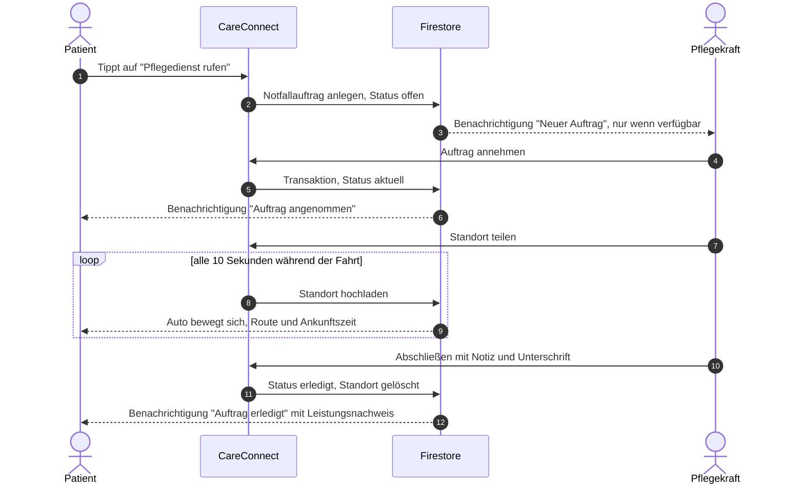
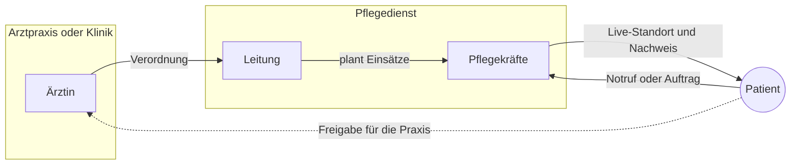
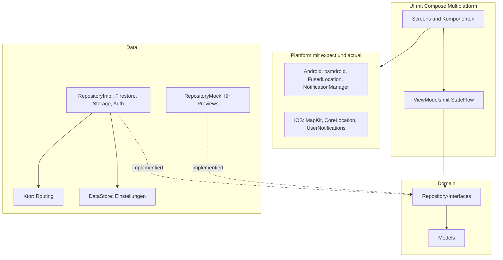

**Eine App. Zwei Plattformen. Alle Beteiligten der Pflege an einem Ort.**

[Highlights](#-highlights) · [Einblicke](#-einblicke) · [Features](#-features) · [Abläufe](#-abläufe) · [Architektur](#-architektur) · [Tech-Stack](#-tech-stack) · [Setup](#-setup)

---

## 💡 Über das Projekt

In der ambulanten Pflege laufen Informationen oft über Zettel, Anrufe und Messenger: Wer fährt zu wem? Wann kommt die Pflegekraft? Was hat die Arztpraxis verordnet?

**CareConnect bringt Pflegedienste, Arztpraxen, Kliniken und Patienten in einer App zusammen.** Patienten lösen mit einem Tipp einen Notfallauftrag aus und verfolgen live, wann Hilfe ankommt – so wie man es von Lieferdiensten kennt. Pflegekräfte sehen ihre Tour für den Tag, nehmen Aufträge an und dokumentieren den Einsatz mit Unterschrift direkt auf dem Handy.

Das Projekt ist der Neubau meiner ursprünglichen iOS-App (SwiftUI) mit **Kotlin Multiplatform**: Geschäftslogik **und** Oberfläche sind einmal in Kotlin geschrieben und laufen nativ auf **Android und iOS**.

| Kotlin-Dateien |        Plattformen        | Rollen |         Sprachen         |     Previews      |
| :------------: | :-----------------------: | :----: | :----------------------: | :---------------: |
|    **~300**    | **2** aus einer Codebasis | **3**  | **5** inklusive Arabisch | **95+** mit Mocks |

---

## ✨ Highlights

### 🚗 Live-Tracking wie bei Lieferdiensten
Der Patient sieht seine Pflegekraft als **Auto auf der Karte**, die **Route über echte Straßen** und eine **Ankunftszeit**. Das Auto gleitet flüssig zur neuen Position. Geteilt wird nur, solange ein Einsatz läuft – und nur nach **Zustimmung beider Seiten**.

### 🏢 Mehrere Organisationen sauber getrennt
Jeder Pflegedienst, jede Praxis und jede Klinik ist eine **eigene Organisation** mit eigenen Daten. Beitritt per **Einladungscode** oder **Suche mit Beitrittsanfrage**, Rollen für Leitung, Mitarbeiter und Patienten – abgesichert durch **Firestore Security Rules**.

### 📄 Verordnungen zwischen Organisationen
Arztpraxen schicken Verordnungen direkt an den Pflegedienst, den der Patient **selbst freigegeben** hat. Der Pflegedienst plant daraus **wiederkehrende Einsätze**, zum Beispiel montags, mittwochs und freitags für vier Wochen.

### ✍️ Digitaler Leistungsnachweis
Beim Abschließen eines Auftrags wird dokumentiert, was gemacht wurde, und der Patient **unterschreibt mit dem Finger**. Der Nachweis ist danach für Pflegekraft und Patient jederzeit einsehbar.

---

## 📱 Einblicke

|                                   Live-Tracking                                   |                               Meine Aufträge                                |                              Mitarbeiter-Home                               |                                 Sprachauswahl                                 |
| :-------------------------------------------------------------------------------: | :-------------------------------------------------------------------------: | :-------------------------------------------------------------------------: | :---------------------------------------------------------------------------: |
|  |  |  |  |
|                          Route, Ankunftszeit und Status                           |                        Laufender Auftrag immer oben                         |                         Status, Tagestour und Team                          |                             Wechsel ohne Neustart                             |

<sub>Design-Vorschau der wichtigsten Screens</sub>

---

## 🧩 Features

### 👩‍⚕️ Für Pflegekräfte und Ärzte

| Bereich                    | Was die App kann                                                                                                              |
| -------------------------- | ----------------------------------------------------------------------------------------------------------------------------- |
| **Startseite**             | Eigener Status (verfügbar, beschäftigt, Pause, frei, Urlaub), Kennzahlen und Team-Übersicht                                   |
| **Heute für dich**         | Alle Einsätze des Tages in zeitlicher Reihenfolge, mit einem Tipp als Tour in Google Maps                                     |
| **Aufträge**               | Annehmen, bearbeiten und abschließen – eine Firestore-Transaktion verhindert, dass zwei Personen denselben Auftrag übernehmen |
| **Leistungsnachweis**      | Notiz und Unterschrift des Patienten, gespeichert am Auftrag                                                                  |
| **Patienten**              | Kontakt, Notfallkontakt, Allergien, Vorgeschichte, Medikamente, Termine und Karte                                             |
| **Verordnungen**           | Senden als Praxis oder Klinik, als Einsätze übernehmen als Pflegedienst                                                       |
| **Organisation verwalten** | Beitrittsanfragen, Einladungscodes, Mitglieder, Rollen und Sichtbarkeit in der Suche                                          |
| **Benachrichtigungen**     | Neue Aufträge und Verordnungen – nur, wenn man gerade arbeitet                                                                |

### 🧓 Für Patienten

| Bereich                | Was die App kann                                                                             |
| ---------------------- | -------------------------------------------------------------------------------------------- |
| **Notruf**             | 112 anrufen, Notfallkontakt anrufen oder einen dringenden Auftrag an den Pflegedienst senden |
| **Meine Aufträge**     | Übersichtliche Liste und Detailseite mit Status-Verlauf und Leistungsnachweis                |
| **Live-Standort**      | Pflegekraft als Auto auf der Karte, mit Route und Ankunftszeit                               |
| **Medikamente**        | Sortiert nach morgens, mittags und abends                                                    |
| **Termine**            | Mit Adresse, Karte und Liste der Dinge zum Mitbringen                                        |
| **Freigaben**          | Selbst bestimmen, welche Praxis Verordnungen an welchen Pflegedienst schicken darf           |
| **Benachrichtigungen** | Auftrag angenommen, erledigt, geändert oder abgesagt                                         |

### ⚙️ Für alle

- 🌍 **Deutsch, Englisch, Türkisch, Arabisch und Spanisch** – Arabisch wird von rechts nach links angezeigt
- 🌙 **Hell- und Dunkelmodus**, die Karte passt sich automatisch an
- 🔄 **Mehrere Organisationen** pro Konto mit schnellem Wechsel
- 🔐 **Datenschutz zuerst:** Standort und Live-Karte nur nach ausdrücklicher Zustimmung, jederzeit abschaltbar

---

## 🔄 Abläufe

### Vom Notruf bis zur Ankunft



### Wer arbeitet mit wem?



---

## 🏛 Architektur

CareConnect folgt **MVVM mit Repository Pattern** und strikter Trennung der Schichten. Die Oberfläche kennt nur ViewModels, ViewModels kennen nur Repository-**Interfaces** – woher die Daten kommen, ist austauschbar.



### Wichtige Entscheidungen

| Entscheidung                               | Warum                                                                                                                                 |
| ------------------------------------------ | ------------------------------------------------------------------------------------------------------------------------------------- |
| **Kotlin Multiplatform statt zwei Apps**   | Eine Logik, eine UI und gleiche Features auf beiden Plattformen – nur Karte, Standort und Benachrichtigungen sind plattformspezifisch |
| **Daten pro Organisation**                 | Saubere Trennung, einfach in Security Rules abzusichern                                                                               |
| **Repository-Mocks**                       | Jede der über 95 Previews läuft ohne Firebase und ohne Koin                                                                           |
| **Transaktion beim Annehmen**              | Zwei Pflegekräfte können denselben Auftrag nie gleichzeitig übernehmen                                                                |
| **Keine kostenpflichtigen Karten-Dienste** | Karte auf Basis von OpenStreetMap und Routing über OSRM funktionieren ohne API-Key                                                    |

<details>
<summary><b>🗂 Datenmodell in Firestore</b></summary>

```text
users/{uid}
 └─ memberships/{orgId}            Rolle und Organisation des Nutzers
organizations/{orgId}
 ├─ members/{uid}                  Rolle in der Organisation
 ├─ invites/{code}                 Einladungscodes
 ├─ joinRequests/{uid}             Beitrittsanfragen
 ├─ employees/{uid}
 ├─ patients/{uid}
 │   ├─ medicines/{id}
 │   └─ appointments/{id}
 ├─ orders/{id}                    Aufträge mit Leistungsnachweis
 ├─ prescriptions/{id}             Verordnungen
 └─ employeeLocations/{uid}        Live-Standort, nur während eines Einsatzes
directory/{orgId}                  Öffentliche Suche nach Organisationen
```

</details>

<details>
<summary><b>📁 Projektstruktur</b></summary>

```text
shared/src/commonMain/kotlin/com/example/careconnect
├── di/                 Koin-Module
├── domain/
│   ├── model/          Datenmodelle, je Klasse oder Enum eine Datei
│   └── repository/     Repository-Interfaces
├── remote/
│   ├── model/          DTOs mit Mappern
│   └── repository/     Firestore-Implementierungen
├── local/              DataStore
├── mock/               Beispieldaten und Repository-Mocks für Previews
├── service/            Standort-Tracking und Benachrichtigungen
├── session/            Aktive Organisation
├── platform/           expect/actual für Karte, Geocoder, Standort, Benachrichtigungen
├── i18n/               Übersetzungen
├── ui/                 Screens, Komponenten und ViewModels pro Feature
└── util/               Helferklassen
androidApp/             Einstieg für Android
iosApp/                 Einstieg für iOS (Xcode)
```

</details>

---

## 🛠 Tech-Stack

| Technologie                                    | Einsatz                                        |
| ---------------------------------------------- | ---------------------------------------------- |
| **Kotlin 2.4 und Kotlin Multiplatform**        | Gemeinsamer Code für Android und iOS           |
| **Compose Multiplatform 1.12 und Material 3**  | Gesamte Oberfläche                             |
| **Firebase** mit dem GitLive SDK 2.7           | Authentication, Firestore in Echtzeit, Storage |
| **Koin 4.2**                                   | Dependency Injection                           |
| **Navigation Compose 2.9**                     | Typsichere Routen mit Kotlinx Serialization    |
| **Ktor 3.5**                                   | Routing über OSRM, optional Adresssuche        |
| **osmdroid** und **MapKit**                    | Karten mit Route und animiertem Fahrzeug       |
| **FusedLocationProvider** und **CoreLocation** | Live-Standort                                  |
| **DataStore Preferences**                      | Sprache, Dunkelmodus, Zustimmungen             |
| **Coil 3** und **FileKit**                     | Bilder laden, Fotos und PDFs auswählen         |
| **kotlinx-datetime**                           | Termine und wiederkehrende Einsätze            |

---

## 🚀 Setup

### Voraussetzungen

- Android Studio mit Kotlin-Multiplatform-Plugin
- Xcode für iOS
- Firebase-Projekt mit **Authentication (E-Mail und Passwort)**, **Firestore** und **Storage**

### 1. Repository klonen

```bash
git clone https://github.com/Ali-C313/CareConnect_Android.git
```

### 2. Firebase verbinden

| Datei                                 | Ziel                                    |
| ------------------------------------- | --------------------------------------- |
| `google-services.json`                | `androidApp/`                           |
| `GoogleService-Info.plist`            | `iosApp/iosApp/`                        |
| `firestore.rules` und `storage.rules` | In der Firebase-Konsole veröffentlichen |

### 3. Starten

```bash
./gradlew :androidApp:assembleDebug
```

Für iOS `iosApp/iosApp.xcodeproj` in Xcode öffnen, das Team in `iosApp/Configuration/Config.xcconfig` eintragen und starten.

> [!TIP]
> Zum Testen des Live-Trackings im Emulator unter **⋯ → Location → Routes** eine Strecke abspielen – das Auto fährt auf dem Handy des Patienten mit.

> [!NOTE]
> In `remote/Secrets.kt` kann optional ein API-Key von `Geoapify` für Adressvorschläge beim Tippen hinterlegt werden. Ohne Key nutzt die App den Geocoder des Geräts.

---

## 🗺 Roadmap

- [x] Organisationen, Rollen und Einladungen
- [x] Live-Tracking mit Route und Ankunftszeit
- [x] Verordnungen und wiederkehrende Einsätze
- [x] Digitaler Leistungsnachweis mit Unterschrift
- [x] Fünf Sprachen, Arabisch von rechts nach links
- [ ] Push-Benachrichtigungen bei geschlossener App über FCM und Cloud Functions
- [ ] Unit- und UI-Tests
- [ ] Chat zwischen Patient und Pflegekraft

---

## 👤 Autor

**Ali Chehab** – App-Entwicklung für Android und iOS am Syntax Institut

[](https://github.com/Ali-C313)

<sub>Entwickelt für alle, die sich jeden Tag um andere kümmern.</sub>
